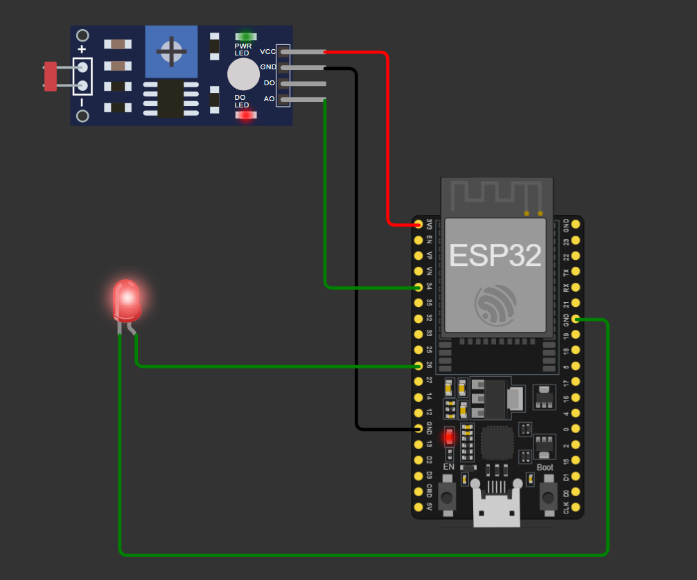
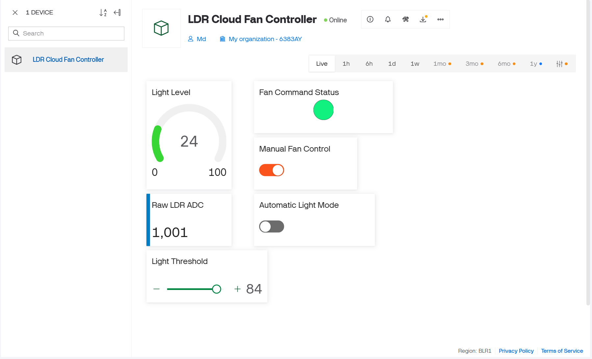
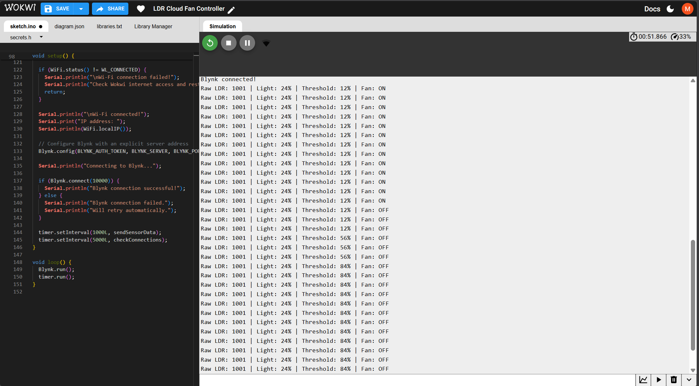

# LDR Cloud Fan Controller — IoT Project

An ESP32-based IoT project that monitors light intensity using an LDR sensor and demonstrates manual and automatic fan control through the Blynk IoT Cloud dashboard. The project is built and tested in the Wokwi online simulator, so it can be demonstrated without physical hardware.

## Project Demonstration

### 1. Wokwi Circuit Simulation

The circuit connects an LDR module to the ESP32 analog input. A simulated output on GPIO26 represents the fan state.



### 2. Blynk IoT Dashboard

The dashboard displays the light level and raw sensor reading, provides manual and automatic mode switches, lets the user adjust the light threshold, and indicates the requested fan state.



### 3. Serial Monitor Output

The Serial Monitor reports the raw LDR ADC value, mapped light percentage, and current simulated fan state.




## Features

- Real-time analog LDR readings
- Mapped light-level percentage for dashboard display
- Blynk Cloud reporting for sensor values and fan state
- Manual fan ON/OFF control from the dashboard
- Automatic control based on a configurable light threshold
- Adjustable threshold using a Blynk slider
- Wokwi simulation for online demonstration without physical hardware
- Serial Monitor output for debugging and testing

## Components and Tools

### Simulation Components

- ESP32 DevKit
- LDR / photoresistor sensor module with analog output
- LED used as a simulated fan-state indicator
- Suitable current-limiting resistor for the LED

### Software and Services

- Wokwi ESP32 Simulator
- Arduino C++ framework
- Blynk IoT Cloud
- Blynk Arduino library
- GitHub for source control and project documentation

## Circuit Connections

| Component | ESP32 connection | Purpose |
|---|---|---|
| LDR VCC | 3V3 | Sensor power |
| LDR GND | GND | Common ground |
| LDR AO | GPIO34 | Analog light reading |
| LDR DO | Not connected | Digital threshold output is unused |
| Simulated fan LED anode | GPIO26 through a current-limiting resistor | Represents fan output state |
| Simulated fan LED cathode | GND | Ground return |

The Wokwi diagram is the source of truth for the exact wiring in the simulation.

## Blynk Datastreams

| Virtual pin | Datastream | Direction | Description |
|---|---|---|---|
| V0 | Light Level | ESP32 → Cloud | Light reading mapped to a 0–100 display scale |
| V1 | Raw LDR ADC | ESP32 → Cloud | Raw ESP32 ADC reading, expected range 0–4095 |
| V2 | Manual Fan | Cloud → ESP32 | Manual fan command: `0` = OFF, `1` = ON |
| V3 | Automatic Mode | Cloud → ESP32 | Mode selector: `0` = manual, `1` = automatic |
| V4 | Light Threshold | Cloud → ESP32 | User-adjustable automatic-mode threshold |
| V5 | Fan State | ESP32 → Cloud | Current requested output state: `0` = OFF, `1` = ON |

## How It Works

### 1. Read the LDR

The ESP32 reads the analog sensor value using GPIO34. The reading is reported as a raw ADC value between 0 and 4095 (12-bit resolution).

### 2. Map the Reading to a Percentage

The firmware maps the ADC reading to a 0–100 display scale for the Blynk gauge. This is a simple mapping for demonstration; it is not a calibrated measurement of lux. Depending on the sensor module and wiring, the percentage may need to be inverted or calibrated for a particular use case.

### 3. Manual Fan Control

With **Automatic Mode** turned OFF, the **Manual Fan** switch determines the fan output:

- `0` → fan output OFF
- `1` → fan output ON

### 4. Automatic Light-Based Control

With **Automatic Mode** turned ON, the firmware compares the mapped light percentage with the configured threshold:

- If the light percentage is greater than or equal to the threshold, the fan output turns ON.
- Otherwise, the fan output turns OFF.

The suitable threshold and the direction of light response should be confirmed using the actual Wokwi sensor behaviour.

### 5. Send Data to Blynk

The ESP32 sends the light percentage to V0, the raw ADC value to V1, and the requested fan state to V5. The dashboard sends manual mode, automatic mode, and threshold settings through V2, V3, and V4.

## Running the Project in Wokwi

1. Open the Wokwi project: **https://wokwi.com/projects/477766097387142145**.
2. Confirm the ESP32, LDR module, and output indicator are present in `diagram.json`.
3. Confirm `libraries.txt` contains the Blynk library dependency:

   ```text
   Blynk
   ```

4. Create a local `secrets.h` file using `secrets.h.example` as a template.
5. Add your own Blynk Template ID, Template Name, and Device Auth Token to `secrets.h`.
6. Start the Wokwi simulation.
7. Check the Serial Monitor for Wi-Fi and Blynk connection messages, including `Ready`.
8. Open your Blynk dashboard and test the manual switch, automatic-mode switch, and threshold slider.
9. Change the virtual photoresistor's light level in Wokwi to verify that the sensor reading changes.

## Project Structure

```text
ldr-cloud-fan-iot/
├── sketch.ino
├── diagram.json
├── libraries.txt
├── secrets.h.example
├── .gitignore
├── README.md
└── screenshots/
    ├── wokwi-circuit.png
    ├── blynk-dashboard.png
    └── serial-monitor.png
```

`secrets.h` is intentionally not listed because it contains private credentials and must be excluded from version control.

## Testing and Current Limitations

The project has been demonstrated in the Wokwi simulation environment with Wi-Fi and Blynk Cloud connectivity. The Serial Monitor reports raw LDR readings, mapped percentage, and fan command state.

- The sensor percentage is a simple mapped value, not a calibrated lux measurement.
- The fan is represented by a simulated output/LED; a physical fan has not been tested as part of this simulation.
- Sensor readings only vary when the simulated photoresistor's light level is changed.
- Automatic-mode behaviour depends on the chosen mapping and threshold and should be verified in the simulator.

## Physical Hardware and Safety

To adapt the project for a real fan, use a properly rated transistor/MOSFET driver or relay module, a suitable separate power supply, and common grounding where required by the driver design. Do not power a fan directly from an ESP32 GPIO pin. Keep electronics protected from moisture and test the hardware safely before leaving it unattended.

## Future Improvements

- Calibrate the light mapping against a known range or convert readings using a suitable sensor model.
- Add filtering or averaging to reduce noisy readings.
- Add hysteresis to prevent rapid switching near the threshold.
- Add Blynk charts and event notifications.
- Test with a physical sensor and a properly driven fan circuit.
- Add screenshots and a short demonstration video to the repository.


## Project Team

| Roll Number | Name |
|---|---|
| 13030824031 | KSHITIJ HARSH |
| 13030824032 | KUNAL SINGH |
| 13030824033 | MAAZ KARIM |
| 13030824034 | MD BELAL |
| 13030824035 | MD SHAKIB |

**Department:** Computer Science & Engineering (Artificial Intelligence & Machine Learning)  
**College:** Techno Main Salt Lake
